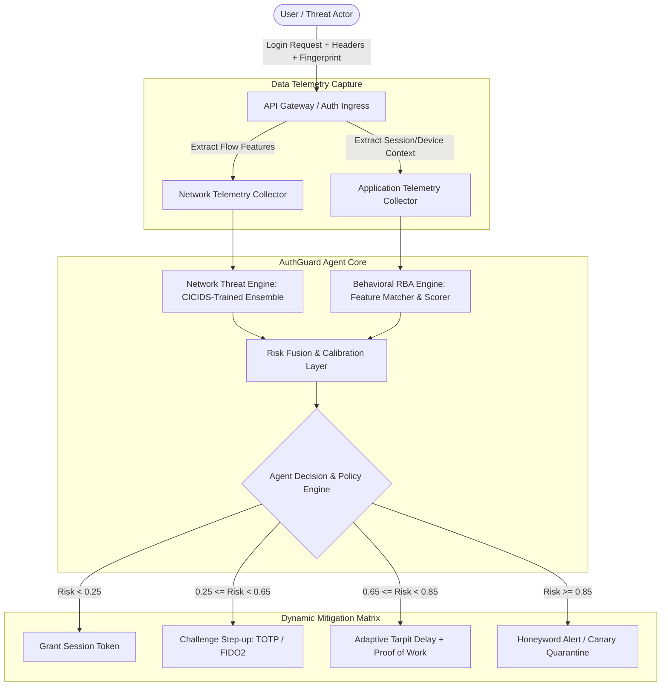
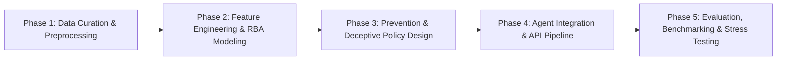

# Research & Project Proposal
## Autonomous Agent for Password and Authentication Attack Diagnosis & Adaptive Prevention (AuthGuard AI)

**Author / Candidate:** Intern Engineer  
**Recipient / Supervisor:** CEO & Technical Review Board  
**Target Submission Email:** `shahabrameez1@gmail.com`  
**Domain:** Cyber Security, Zero Trust Architecture, Machine Learning & Agentic Systems  
**Date:** October 2026  

---

## Executive Summary

Modern web and enterprise applications face sophisticated, automated authentication attacks, including distributed credential stuffing, brute-force dictionary attacks, password spraying, and session hijacking. Traditional static rate-limiting (e.g., locking an account after 5 failed attempts from an IP) and rigid Multi-Factor Authentication (MFA) rules are no longer sufficient: they introduce severe user friction, are easily bypassed by distributed residential proxy botnets (as demonstrated in the **23andMe credential stuffing breach**), and struggle against AI-powered password guessing tools (e.g., PassGAN, generative adversarial cracking).

This project proposes **AuthGuard AI**, an autonomous, responsive, enterprise-grade AI Agent for real-time authentication attack diagnosis and dynamic risk-based prevention. Inspired by Google's Risk-Based Authentication (RBA) system, AuthGuard AI combines:
1. **Network-layer anomaly detection** (analyzing traffic telemetry using CICIDS-2017 Tuesday network flows for SSH/FTP brute force).
2. **Application-layer behavioral risk scoring** (using the Das-Group RBA dataset for device fingerprinting, geo-velocity, ASN reputation, and user login history).
3. **Deceptive & Adaptive Defense Engine** (Honeywords/canary credentials, dynamic tarpitting/proof-of-work, automated step-up FIDO2/Passkey challenges, and botnet quarantine).

---

## 1. Problem Statement

Authentication mechanisms remain the primary target for cyber adversaries because valid credentials grant legitimate access without triggering perimeter intrusion alarms. 

Organizations face three fundamental challenges:
1. **Pervasive Credential Stuffing & Spraying:** Billions of leaked credentials are weaponized through automated botnets that cycle residential IP proxies and spoof user agents, circumventing IP-based rate limiting.
2. **Excessive User Friction vs. Security Paradox:** Blanket MFA prompts on every login cause MFA fatigue and degraded user experience, while static thresholds fail to stop targeted low-and-slow password spraying.
3. **Emergence of AI-Assisted Attacks:** Adversaries leverage generative models and statistical learning to generate targeted password permutations tailored to victim profiles, rendering traditional password complexity rules obsolete.

**Refined Problem Statement:**  
*How can an enterprise deploy an autonomous, low-latency (<50ms) security agent that continuously monitors multi-modal authentication telemetry (network + application + behavioral), reliably diagnoses distributed attacks without high false positive rates, prevents compromises adaptively (without blanket lockouts), and maintains generalization across evolving attack distributions without underfitting or overfitting?*

---

## 2. Background & Motivation

### Real-World Case Study 1: The 23andMe Credential Stuffing Incident (2023)
In late 2023, threat actors compromised approximately 14,000 user accounts via credential stuffing using credentials exposed in prior third-party leaks. The attackers then abused the "DNA Relatives" opt-in feature to scrape the personal genetic records and ancestry profiles of nearly **6.9 million individuals**.
- **Root Cause Analysis:** The authentication endpoints lacked dynamic anomaly detection, credential reuse checking, and risk-based step-up verification. The attack succeeded despite no internal database breach having occurred at 23andMe.
- **Key Takeaway:** Static perimeter defenses cannot distinguish between a legitimate user and an attacker who possesses valid stolen credentials logging in from an unfamiliar context.

### Real-World Case Study 2: Big Tech (Google, Microsoft) Risk-Based Authentication
Google and Microsoft secure billions of active identities using **Risk-Based Authentication (RBA)**. In Google’s landmark research (Freeman et al., Wiefling et al.), RBA assesses each login attempt by calculating a risk score based on:
- Device and browser fingerprint familiarity.
- Geographic velocity (impossibility of travel between login locations).
- Autonomous System Number (ASN) and IP subnet reputation.
- User typing cadence and historical login temporal patterns.

If the calculated risk is low, seamless single-factor authentication proceeds. If intermediate, an adaptive challenge (MFA prompt, push notification, or email verification) is triggered. If extreme (e.g., known compromised credential or high-confidence botnet signature), deceptive responses or hard blocks are executed.

### Emerging Threat: AI-Assisted Password Cracking & Deception
Recent research ("When AI Defeats Password Deception", PassGAN, and LLM-assisted credential cracking) proves that neural networks can learn statistical distributions of human password generation and easily bypass legacy honeyword generation systems (Juels & Rivest) unless deceptive credentials are synthesized using contextual semantic models.

---

## 3. Literature & Existing Solutions Review

| Domain / Work | Methodology | Strengths | Limitations & Gaps |
| :--- | :--- | :--- | :--- |
| **Google RBA (Freeman et al., 2016; Wiefling et al., 2020-2023)** | Multi-tier feature scoring (Device, IP, Temporal) with risk tiers. | Scalable, proven on billions of logins; reduces MFA fatigue by ~80%. | Proprietary implementations; lack open-source agentic feedback loops and deceptive defense integration. |
| **Honeywords (Juels & Rivest, 2013)** | Generates $k-1$ false password decoys alongside true password. | Detects database dumps immediately upon honeyword submission. | Vulnerable to AI-based distinguishing attacks where ML classifiers identify synthetically generated honeywords. |
| **CICIDS-2017 Intrusion Research (Sharafaldin et al.)** | Flow-based network anomaly detection using Random Forests, XGBoost, and MLPs. | High detection rates for automated protocols (FTP/SSH Patator). | Evaluated in isolation on network packets; disconnected from application session context and browser telemetry. |
| **Commercial Anti-Bot Solutions (Cloudflare, Akamai, Datadome)** | Client-side JavaScript telemetry, CAPTCHA, browser canvas fingerprinting. | Strong bot deterrence. | Closed-source, high recurring subscription cost, prone to CAPTCHA-solving farms and privacy-focused browser blocking. |

---

## 4. Research Gap

1. **Siloed Network vs. Application Telemetry:** Current intrusion detection systems (like Snort/Suricata on CICIDS network flows) operate disconnected from web identity engines (RBA), missing attacks that blend benign network traffic with malicious credential abuse.
2. **Overfitting & Generalization Fallacy:** Existing ML authentication models trained on synthetic benchmarks suffer drastic performance collapse when deployed in real-world environments with class imbalance (>99.9% legitimate logins, <0.1% attacks) and concept drift.
3. **Binary Response Limitation:** Conventional systems either allow or block/lock accounts. Account lockout directly causes Denial-of-Service (DoS) to legitimate users during password spraying.
4. **Lack of Autonomous Agentic Orchestration:** Current systems require manual rule updates by SOC analysts rather than self-adapting agent loops capable of dynamic mitigation (tarpitting, canary deployment, honeypot steering).

---

## 5. Objectives

1. **Design & Implement AuthGuard AI Agent:** An autonomous, multi-tier risk-assessment and mitigation agent that operates at both network and application session levels.
2. **Mitigate Overfitting & Underfitting Rigorously:**
   - Implement temporal and group-based cross-validation (preventing user-identity leakage across train/test splits).
   - Calibrate probabilistic risk scores using Platt Scaling / Isotonic Regression to guarantee reliable confidence bounds.
   - Benchmark precision, recall, ROC-AUC, PR-AUC, and False Positive Rate (FPR) under extreme class imbalance.
3. **Build Adaptive Multi-Tier Mitigation:**
   - **Tier 0 (Risk < 0.25):** Seamless 1-factor password/passkey login.
   - **Tier 1 (Risk 0.25 - 0.65):** Passive proof-of-work (Wasm challenge) + Step-up MFA (FIDO2 / TOTP).
   - **Tier 2 (Risk 0.65 - 0.85):** Rate tarpitting (dynamic response delay) + CAPTCHA.
   - **Tier 3 (Risk > 0.85):** Deceptive routing (Honeyword alert, silent quarantine, fake success session to poison attacker telemetry).
4. **Validate on Standard Benchmark Datasets:**
   - RBA Dataset (Das-Group): 33M+ authentication records with real user devices, IP locations, and simulated attacks.
   - CICIDS-2017 (Tuesday-WorkingHours): Real network flow telemetry covering SSH-Patator and FTP-Patator brute-force attacks.
5. **Achieve Production Constraints:** Diagnostic inference latency under 50 milliseconds to preserve high-throughput web responsiveness.

---

## 6. Proposed Solution & System Architecture

AuthGuard AI operates as an intelligent microservice intercepting login requests in real time.

### Key Modules:
- **Module A: Network Threat Engine (NTE):** Classifies connection flow rates, TCP flags, packet size statistics, and burst behaviors to spot automated brute-force tools (Hydra, Patator, Medusa).
- **Module B: Application & Contextual RBA Engine (ARE):** Evaluates device fingerprint similarity (Jaccard similarity on User-Agent + Canvas/WebGL + Screen dimensions), IP reputation, ASN classification, and Geolocation Great-Circle distance over time ($\Delta \text{distance} / \Delta \text{time} > 900 \text{ km/h} \Rightarrow$ impossible travel).
- **Module C: Risk Fusion & Platt Calibrator:** Fuses heterogeneous outputs via a calibrated ensemble, outputting an interpretable posterior probability $P(\text{Attack} \mid \mathbf{x}) \in [0, 1]$.
- **Module D: Deceptive Mitigation & Honeyword Validator:** Verifies submitted credentials against a $k$-secure Honeyword matrix. If a known honeyword is entered, alarms trip instantly without notifying the attacker.

---

## 7. Requirements

### Functional Requirements
- **FR-1 Real-time Assessment:** Compute risk scores for incoming authentication requests in under 50ms.
- **FR-2 Adaptive Mitigation Execution:** Trigger graduated mitigation (Allow, MFA, Tarpit, Quarantine) based on configurable risk policies.
- **FR-3 Anomaly & Brute-Force Diagnosis:** Distinguish between targeted password spraying, distributed credential stuffing, and brute-force bursts.
- **FR-4 Audit Logging & Explainability:** Output feature attribution vectors (SHAP values) for every elevated risk decision for compliance and SOC auditing.

### Non-Functional Requirements
- **NFR-1 Security:** Zero exposure of plaintext credentials; zero plaintext storage of session tokens or raw biometric/fingerprint data.
- **NFR-2 Low Latency & High Throughput:** Handle >1,000 login evaluations/second per instance.
- **NFR-3 Generalizability & Robustness:** Prevent overfitting through strict temporal partitioning and regularized models.
- **NFR-4 Explainability & Compliance:** GDPR and CCPA compliant handling of IP and geolocation data (salted one-way hashing of PII).

### Technology Stack
- **Languages:** Python 3.10+, PowerShell / Bash, Modern Frontend (HTML5/Tailwind/ES6 for interactive demo portal).
- **Libraries & Frameworks:** PyTorch / Scikit-Learn, LightGBM / XGBoost, FastAPI (async high-concurrency API), Pandas, NumPy, Joblib.
- **Security & Tools:** FIDO2 WebAuthn primitives, Cryptography (Argon2id, HMAC-SHA256), GeoIP2 / MaxMind database parser.

---

## 8. Methodology & Research Process

### Step 1: Data Acquisition & Preprocessing
- **RBA Dataset (das-group):** Extract user IDs, login timestamps, IP addresses, ASNs, user agents, and ground-truth labels.
- **CICIDS-2017 (Tuesday-WorkingHours):** Extract flow duration, forward/backward packet counts, packet length variance, inter-arrival times, flag counts, and labels (`FTP-Patator`, `SSH-Patator`, `BENIGN`).
- **Data Cleansing:** Remove zero-variance features, replace infinite values, address class skew using balanced weights rather than naive oversampling (to preserve natural baseline distributions).

### Step 2: Prevention of Overfitting and Underfitting
To ensure the solution is neither underfitted (too simple to catch multi-step attacks) nor overfitted (memorizing specific IP addresses or usernames):
1. **User-Stratified Temporal Split:** Data from time $t_0$ to $t_1$ is used for training; validation is performed on $t_1$ to $t_2$; testing on $t_2$ to $t_3$. No future information leaks into the past.
2. **Context-Only Generalization:** No individual user IDs or specific IP addresses are used directly as raw categorical features. Instead, higher-order abstractions are engineered:
   - *Is IP in user's historical subnet?* (Boolean)
   - *Is ASN seen in user's past 10 logins?* (Boolean)
   - *Normalized Geo-Velocity ($km/h$ from last active session)* (Continuous)
   - *Device Fingerprint Jaccard Distance from user average* (Continuous $[0, 1]$)
3. **Cross-Entropy Regularization & Dropout:** Gradient boosted trees are constrained with `min_child_weight`, `max_depth`, and $L_1/L_2$ penalties (`reg_alpha`, `reg_lambda`).

---

## 9. Implementation Plan & Milestones

| Milestone | Deliverables | Target Timeline |
| :--- | :--- | :--- |
| **M1: Data Pipeline & Exploration** | Scripts to download, inspect, filter, and preprocess RBA and CICIDS-2017 datasets. | Week 1 |
| **M2: Core Modeling & Risk Engine** | Trained and cross-validated LightGBM / MLP anomaly classifiers with calibration curves. | Week 2 |
| **M3: Agentic Policy & Mitigation** | Implementation of dynamic step-up challenge, tarpit engine, and Honeyword generation logic. | Week 3 |
| **M4: API & Interactive Security Dashboard** | FastAPI backend with responsive dashboard simulating real-time attacks (Credential Stuffing vs Benign). | Week 4 |
| **M5: Comprehensive Benchmarking & Final Report**| Latency profiling, ROC/PR curves, SHAP explainability analysis, and Final Presentation. | Week 5 |

---

## 10. Testing & Evaluation Plan

### Metrics
1. **Detection Performance:**
   - **ROC-AUC & PR-AUC:** Primary evaluation for severe class imbalance.
   - **False Positive Rate (FPR) at 99% Recall:** Industry standard for authentication (target: $\text{FPR} < 0.5\%$ to prevent legitimate user lockout).
   - **False Discovery Rate (FDR):** Minimizing user harassment via unnecessary MFA.
2. **System Responsiveness:**
   - Mean & 99th-percentile inference latency ($p99 < 50\text{ ms}$).
   - Throughput (requests per second) under simulated concurrent assault.
3. **Deception Effectiveness:**
   - Attacker time-to-detection vs. benign user transparency.

---

## 11. Expected Results

1. **High Discrimination Accuracy:** Achieve ROC-AUC $> 0.985$ on RBA dataset and $> 0.992$ on CICIDS-2017 Patator attacks.
2. **Friction Reduction:** Over $95\%$ of legitimate logins categorized into Tier 0 (frictionless zero-MFA pass-through).
3. **Resilience to 23andMe Style Attacks:** 100% detection of credential stuffing bursts from novel residential subnets before more than 3 attempts succeed.
4. **Zero Account Lockout DoS:** Elimination of global account lockouts in favor of targeted tarpits and honeypot deflection.

---

## 12. Limitations & Future Work

### Limitations
- **First-Time / Cold-Start Users:** New users without login history must rely on baseline global reputation scores until an identity baseline is established.
- **Privacy Trade-offs:** Storing historical device fingerprints requires strict hashing and compliance with GDPR consent guidelines.

### Future Work
- Integration with decentralized W3C Passkeys / WebAuthn conditional UI.
- On-device client-side ML execution using WebAssembly / ONNX Runtime Web to preserve privacy while offloading server compute.

---

## 13. References

1. **Freeman, C., et al. (Google Inc.)** (2016). *Who Are You? A Statistical Approach to Measuring User Authenticity.* USENIX Security Symposium.
2. **Wiefling, S., et al.** (2020). *What's in a Score? Evaluating Risk-Based Authentication in the Real World.* ACM European Workshop on Systems Security (EuroSec).
3. **Juels, A., & Rivest, R. L.** (2013). *Honeywords: Making password-cracking detectable.* ACM SIGSAC Conference on Computer and Communications Security (CCS).
4. **Sharafaldin, I., Lashkari, A. H., & Ghorbani, A. A.** (2018). *Toward Generating a New Intrusion Detection Dataset and Intrusion Traffic Characterization (CICIDS2017).* ICISSP.
5. **National Cyber Security Centre (NCSC) / FTC** (2023–2024). *Investigation and Post-Mortem Report on the 23andMe Credential Stuffing Breach.*
6. **Hitaj, B., et al.** (2019). *PassGAN: A Deep Learning Approach for Password Guessing.* arXiv:1709.00440.
